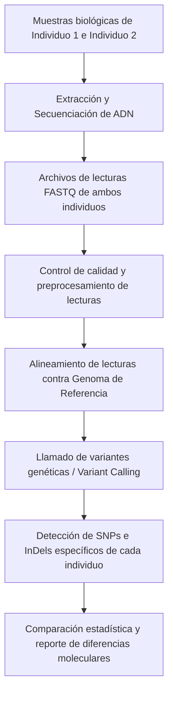

# Desafío VI

## Enunciado
¿Qué hace distintos a dos individuos de una especie? Propone una forma de corroborar tu respuesta realizando un diagrama de un posible método computacional para dicho fin.

## Respuesta

### 1. ¿Qué hace distintos a dos individuos de una especie?
A nivel molecular, las diferencias entre dos individuos de la misma especie radican principalmente en las **variaciones en sus secuencias de ADN (material genético)**. Entre estas variaciones se destacan:
- **Polimorfismos de nucleótido simple (SNPs):** Cambios de una sola base nucleotídica (por ejemplo, una A por una G).
- **Inserciones y deleciones (InDels):** Ganancia o pérdida de pequeños fragmentos de nucleótidos.
- **Variaciones en el número de copias (CNVs) y reordenamientos estructurales:** Duplicaciones, inversiones o pérdidas de segmentos más extensos de ADN.

*(Estas diferencias genéticas, en conjunto con factores epigenéticos y la influencia del ambiente, se traducen en variaciones fenotípicas).*

---

### 2. Diagrama del método computacional para corroborarlo

Un flujo de trabajo computacional (pipeline bioinformático) para identificar y comparar las diferencias genéticas entre dos individuos consiste en:

#### Descripción de los pasos:
1. **Secuenciación:** Obtención de los datos crudos de secuencia (lecturas) de cada individuo.
2. **Alineamiento:** Mapeo de las secuencias contra un genoma de referencia de la especie.
3. **Identificación de variantes (*Variant Calling*):** Localización de las posiciones donde cada individuo difiere de la referencia.
4. **Comparación directa:** Cruce computacional para contabilizar y caracterizar los sitios donde las secuencias de ambos individuos son distintas entre sí.
